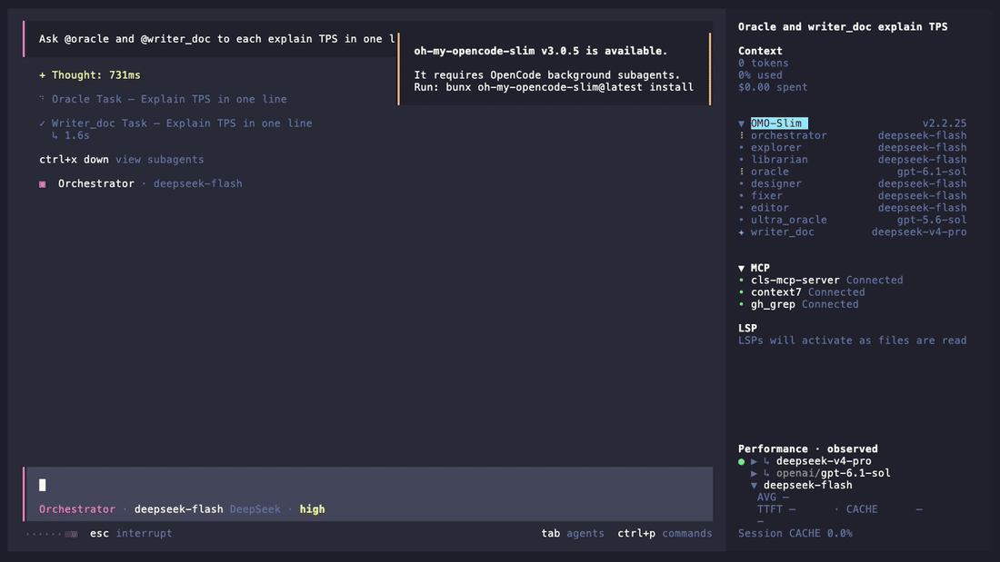

# opencode-tui-stats

OpenCode 1.x（v1）的 TUI 插件，在会话提示区右侧显示一行 `TPS | AVG | TTFT`。

## 演示



## 安装

```bash
opencode plugin opencode-tui-stats --global
```

该命令会把插件写入 opencode 的 tui 配置。也可以从 npm 安装 `opencode-tui-stats` 包。

## 环境要求

- opencode ≥ 1.3.14

## 指标说明

- `TPS`：最近约 5 秒流式窗口内的实时生成速度（token/秒）；会话空闲或数据过期时显示 `-`。
- `AVG`：本会话已完成消息的平均生成速度（token/秒）。
- `TTFT`：本会话已完成消息的平均首字延迟（秒）。

## License

MIT，详见仓库根目录的 [LICENSE](./LICENSE)。
